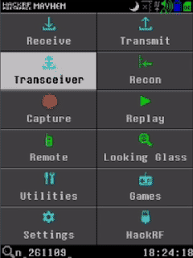
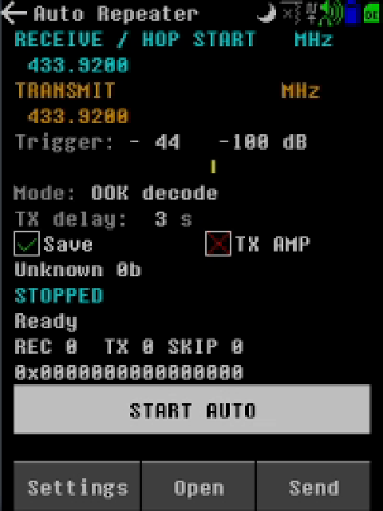
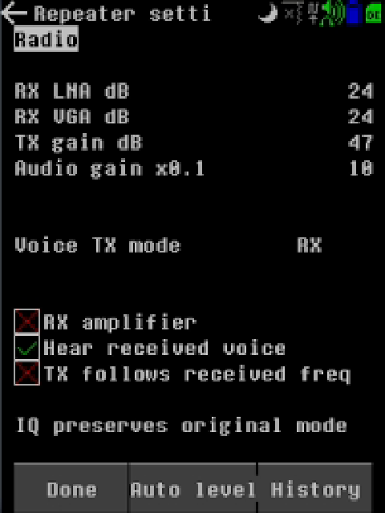
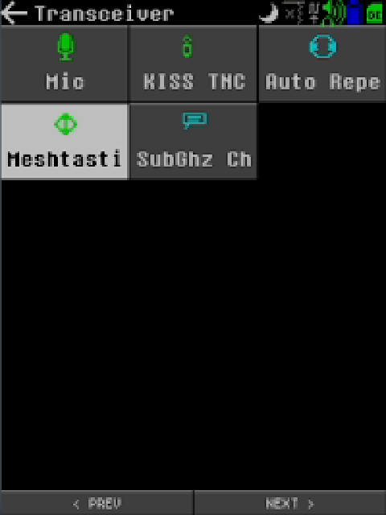
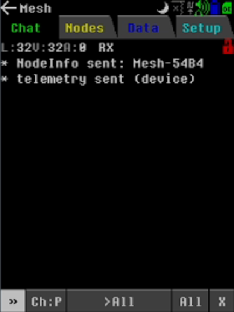
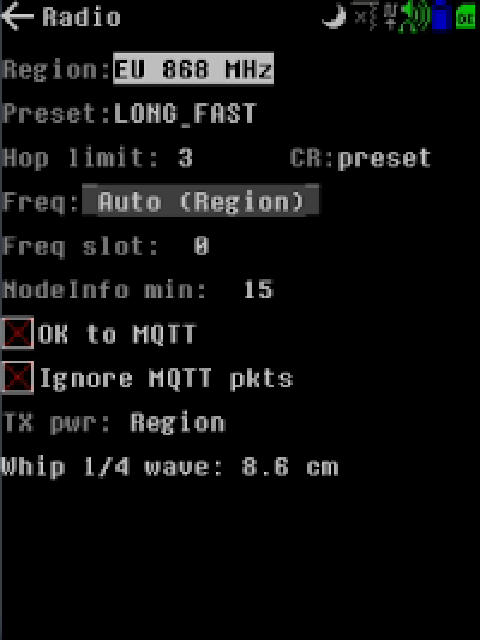

# H4M Auto Repeater + Meshtastic

Latest test build: [ar05 downloads and changes](https://github.com/Nhscan/H4M-Repeater-Meshtastic/releases/tag/ar05). Includes the complete SD-card and Windows flash package.

Community test firmware for **HackRF One + PortaPack H4M**, based on Mayhem nightly **n_261109**.



▶️ **[Watch the full screen walkthrough video (5 min)](docs/h4m/media/H4M-v0.3.1-screen-demo.mp4)**

## What's in this build

This firmware adds two new apps to the HackRF/PortaPack H4M, both found under **Transceivers (TRX)**:

### 📡 Auto Repeater
A store-and-forward "parrot" repeater for the PortaPack. It sits on a receive frequency and listens. When a signal rises above your trigger level, it records it to the SD card. When the signal stops, it waits a short delay and transmits the recording back out, on the same frequency or on a separate TX frequency. Then it rearms for the next one. It works with raw IQ (any signal), with voice modes (NFM, FM, AM, USB, LSB, WFM), and with OOK remotes. In OOK mode it can recognize many common key-fob and sensor protocols live and export Flipper Zero `.sub` files. An **Auto level** button sets the trigger from the background noise for you. **REC / TX / SKIP** counters show what it's doing at a glance.

### 💬 Meshtastic (experimental, needs testers!)
A native Meshtastic client that runs entirely on the HackRF, using software-defined LoRa with no external LoRa radio. It has **Chat**, **Nodes**, **Data** and **Setup** tabs. You can join a mesh by matching region, modem preset, channel and key with your other nodes, then send and receive text messages, NodeInfo and telemetry.

> **ar05 hardware test:** The H4M imported a 256-bit Base64 channel key and exchanged text in both directions with a LILYGO T3 running Meshtastic 2.7.26. This was a Short Fast bench test at 433.125 MHz. Repeated-delivery reliability and broader hardware/preset coverage need more testing.

## Screenshots

| Auto Repeater | Repeater settings | Transceivers menu |
|:---:|:---:|:---:|
|  |  |  |

| Meshtastic chat | Meshtastic radio setup |
|:---:|:---:|
|  |  |

## Download and install ar05

**[Download the complete SD-card and Windows flash package](https://github.com/Nhscan/H4M-Repeater-Meshtastic/releases/download/ar05/H4M-Meshtastic-ar05-SD-and-Flash.zip)**

Firmware version **`n_261109_ar05`**. This community test package contains matching APPS, BASEBAND, firmware, Windows USB tools/drivers, instructions and checksums. [Release notes](docs/h4m/AR05-RELEASE-NOTES.md) | [Changelog](CHANGELOG.md)

1. Extract the ZIP. Copy everything **inside SD_CARD** to the SD card root. Merge folders and replace matching files while retaining your other data.
2. Open **Utilities > Flash Utility** on the PortaPack and select **H4M_AR05_FIX.ppfw.tar**.
3. Wait for completion, restart, and confirm About shows **n_261109_ar05**.
4. Open **Transceivers / TRX > Meshtastic**.

Use the corrected **FIX** archive supplied in the release. Earlier ar05 packaging used extended TAR headers unsupported by the updater.

**Windows USB alternative:** Copy the SD files first. Connect USB, select **HackRF mode** on the PortaPack, and run **USB_FLASH_WINDOWS/START_H4M.bat**. It backs up flash, writes ar05 and verifies a byte-for-byte read-back. Wait for SUCCESS before restarting. Older custom v0.2.x builds require USB because they lack the internal updater.

Use this build's matching **104 PPMA apps**, two standalone apps and BASEBAND files. Mixing builds can cause app compatibility errors. [Previous v0.3.1 release](https://github.com/Nhscan/H4M-Repeater-Meshtastic/releases/tag/v0.3.1)

## Auto Repeater

- Half-duplex store-and-forward operation with separate RX and TX frequencies, or TX following the received frequency.
- Signal-level trigger, end-silence timer, maximum capture duration, **1–30 second TX delay**, cooldown and automatic rearming.
- Save/discard after successful transmission, record-only mode, repeat count/gap, RX/TX gain and amplifier controls.
- Raw IQ; NFM, FM, AM, USB, LSB and mono WFM voice modes; optional voice monitoring.
- OOK mode adds live frame/protocol recognition where an included decoder recognizes the signal.
- Optional receive-frequency hopping; recording and transmission hold the selected channel.
- Flipper `.sub` **RAW/BinRAW** playback for supported OOK/2FSK presets. Compatible OOK recordings can also export as Flipper RAW `.sub` files.

### v0.3.1 repeater fixes

The Start/Stop caption updates only when it changes. Other text refreshes at most five times per second, reducing redundant LCD writes.

Capture-quality checks cover the retained prebuffer and current event rather than the entire idle listening session. Silence below the selected trigger ends a recording; the optional rearm margin no longer holds a short event open below the noise floor.

A capture with real sample gaps is saved and counted as **SKIP**, then Auto returns to listening after cooldown. It is not automatically transmitted or exported as `.sub`. Clean captures follow the normal delay, transmission and rearm sequence. Actual file/SD errors still stop with their specific error.

For a first test, choose one known RX frequency, disable hopping, keep Save checked, and use **Settings → Auto level** with the remote quiet. Watch the **REC / TX / SKIP** counts.

## Meshtastic setup and keys

### Match both radios

Match the actual frequency, bandwidth, spreading factor and coding rate. A matching modem preset is the easiest starting point. Match the channel name exactly, including capitalization, and use the same key bytes.

Secondary channels share the primary channel's RF frequency. Adding one does not create another frequency. An explicit frequency slot on the standard node can keep the radios aligned.

Our bench test used a secondary channel named `test`, Short Fast and 433.125 MHz on 433 MHz hardware. Choose hardware and settings appropriate to your region and operating authorization.

### Get a key from your existing node

Ask the channel owner to share the channel name and PSK securely, or copy it from a node you own.

With the node connected to **client.meshtastic.org**:

1. Open **Settings > Radio Config > Channels**.
2. Select the channel.
3. Find **Pre-Shared Key** and use **Show password** or **Copy to clipboard**.
4. Copy the Base64 PSK exactly, including trailing `=` padding. Record the exact channel **Name** too.

Use the **channel PSK** from Channels. A node's public key from Security or NodeInfo belongs to direct-message PKC and cannot serve as the channel PSK.

### Generate a new private key

1. In the standard web client's **Settings > Radio Config > Channels**, choose a spare channel.
2. Set the role to **SECONDARY** and enter a short channel name.
3. Select **256 bit** next to the PSK and click **Generate**.
4. Click **Save**, then copy the generated key.
5. Set up a custom channel with that same name and key on the PortaPack.

Share a private PSK only with the people joining that channel. Anyone with that key and matching settings can decode channel traffic. Our bench test used a recognizable test fixture. Generate a fresh key for private use.

### Import a key from the SD card

1. On your computer, create a plain-text file such as **MYKEY.TXT**.
2. Paste **only the PSK** on one line. Include Base64 padding. Use no quotes, spaces, labels or `key=` prefix. A trailing line ending is accepted.
3. Save as ASCII or UTF-8 **without a BOM** and check the filename ends in **.TXT**.
4. Copy the file to your PortaPack's SD card, for example its root.
5. Open **Mesh > Chat**, then press **Ch:** at the bottom to open the channel list.
6. Select an empty custom slot, enter the exact channel name and confirm. The channel becomes enabled and active.
7. Reopen the channel list and highlight that custom channel with the D-pad or encoder.
8. Press **Import key**, browse to the file, highlight it and press Select to open it.
9. Select your custom channel for chat and choose **>All** to test channel messages.

Import loads the key only. Set the name and radio parameters separately. Ar05 silently keeps the previous key if the file cannot be read or parsed. If nothing appears to change, check the encoding, file contents and supported lengths below. An empty file does not clear the key.

The key file stays on the SD card. Protect the card and any copies when using a private PSK.

### Type a key manually

Activate the custom channel, then select it again in the channel list to open the key editor. Type the key and press **OK**. The editor accepts up to 64 characters.

| Format | What to enter |
| --- | --- |
| AES-128 hex | Exactly 32 hex digits, without spaces or a `0x` prefix |
| AES-256 hex | Exactly 64 hex digits, without spaces or a `0x` prefix |
| AES-128 Base64 | Standard padded 24-character PSK |
| AES-256 Base64 | Standard padded 44-character PSK |
| Meshtastic short PSK | Padded 4-character form such as `AQ==`, the well-known default |
| Open custom channel | Leave the typed key empty and confirm |

The hex and Base64 forms must represent the same bytes on both nodes. Select the matching format in your other client.

Other typed text retains this app's legacy passphrase derivation. A passphrase is not automatically a standard Meshtastic PSK. Use valid raw hex or padded Base64 when joining standard nodes. Import accepts supported encoded keys, rather than arbitrary passphrases. Nonzero short-PSK indexes are supported. Use an empty typed key to configure an open channel.

**Rnd key** generates a 128-bit hex key. Generate a new 256-bit key in the standard client and import or type it here.

### Primary channel, padlock and direct messages

This build's primary channel uses the well-known default Meshtastic key. Use a **custom channel** for a private PSK.

A green custom-channel padlock indicates a key is configured. Successful message reception confirms whether the other node matches. The widely known default key does not provide private channel access control.

**Encrypt DMs (PKC)** is a separate direct-message setting. Select your custom channel and **>All** for channel tests. A **key requested** line relates to node public-key exchange, not proof of a matching channel PSK.

### Test sending and receiving

1. Select the same custom channel on both radios.
2. Send a short, distinctive text from your standard node and confirm the exact text appears on the PortaPack.
3. Press **>>** in PortaPack chat, type another short message and press **OK**. Confirm it appears on the other node.
4. Repeat several times. A local sent entry or SDR transmission alone does not establish delivery.

**Verified on ar05:** Import of a 256-bit Base64 key, the green custom-channel padlock and text reception in both directions with a LILYGO T3. Manual 256-bit typing, additional keys/presets and DM PKC still need hardware testing. Repeated-delivery reliability remains under investigation.

**Receive limitations:** SF12 reception is disabled. The SF7 ring holds 92 symbols and can truncate long packets. SF8-11 timing and broader RF interoperability need further testing. [Additional Meshtastic background](docs/h4m/MESHTASTIC.md).

## Signal and file limitations

Raw IQ repeats a recorded waveform; protocol recognition is not required for raw recording. OOK recognition identifies supported frame formats, not every manufacturer/model. It does not decrypt or synthesize rolling codes, and replay acceptance is not guaranteed.

`.sub` export is amplitude-sliced OOK RAW, not a universal IQ-to-Flipper conversion. Voice/FSK/arbitrary RF recordings cannot all be exported as OOK. Encoded protocol/key `.sub` files and custom presets are not synthesized by the importer; use supported RAW/BinRAW captures.

## Testing and feedback

Please include these details when sharing test results:

- Hardware and firmware version shown in About.
- Mode, RX/TX frequency, sample rate, trigger and end-silence settings.
- Whether hopping, Save, Record only or an amplifier was enabled.
- REC / TX / SKIP counts and the exact on-screen error, if any.
- Whether a second receiver/node observed the expected transmission.

Build checks cover the 1 MiB firmware checksum and version, all 104 PPMA identifiers/checksums, external-app layout, runtime LoRa memory budget, updater residency and final archive ordering. Host regressions cover repeated automatic cycles, capture-loss windows, UI repaint suppression, file conversion, a synthetic Princeton IQ waveform and imported Meshtastic protocol tests. These checks do not replace physical RF/SD/UI validation.

## Source and building

This repository contains the complete modified firmware source. The original base is Mayhem tag [`nightly-tag-2026-11-09`](https://github.com/portapack-mayhem/mayhem-firmware/releases/tag/nightly-tag-2026-11-09), commit `706fd7f91e0318fc4643e8d31f5087ececb312c4`.

Ar05 also incorporates upstream changes through `2b7e3b4023b46d4e2c557ffa205a1e02a8caef12`.

Use GNU Arm Embedded **GCC 9.2.1**, Ninja and the dependencies listed in [BUILD.txt](docs/h4m/BUILD.txt):

```sh
git clone --recurse-submodules --branch next https://github.com/Nhscan/H4M-Repeater-Meshtastic.git
cd H4M-Repeater-Meshtastic
python3 tools/update_external_tier_ld.py
cmake -S . -B build -G Ninja -DCMAKE_POLICY_VERSION_MINIMUM=3.5 \
  -DMAYHEM_CUSTOM_VERSION=n_261109_ar05
cmake --build build --target oci -j6
python3 tests/auto_repeater/check_layout.py build
python3 tests/auto_repeater/check_runtime_memory.py build
python3 tests/auto_repeater/check_install.py build n_261109_ar05
```

The custom version is cached so CMake regeneration does not silently change app compatibility. The internal flash writer **PFUT** is included in SPI alongside the LoRa and factory images.

## Credits and license

- [PortaPack Mayhem](https://github.com/portapack-mayhem/mayhem-firmware) and its contributors. The original project README is preserved as [README-UPSTREAM.md](README-UPSTREAM.md).
- Experimental Meshtastic software-LoRa implementation by **Alexey Verhogladov**, imported from [`mamapapa1/mayhem-firmware`, `mesh-test-1`](https://github.com/mamapapa1/mayhem-firmware/tree/mesh-test-1), commit `9d028dd349b9f38dcc897ca2a071d91adec3e851`. Existing copyright notices are retained.
- OOK recognizers and their upstream Flipper-related acknowledgements remain in the source headers. LoRa framing sources acknowledge gr-lora_sdr and related research.
- Windows recovery utilities/drivers are redistributed unchanged from the official `n_261109` firmware asset, with provenance in the package credits.

See [LICENSE](LICENSE), [LICENSE.GPL-2.0-or-later](LICENSE.GPL-2.0-or-later), and the individual source-file notices.
